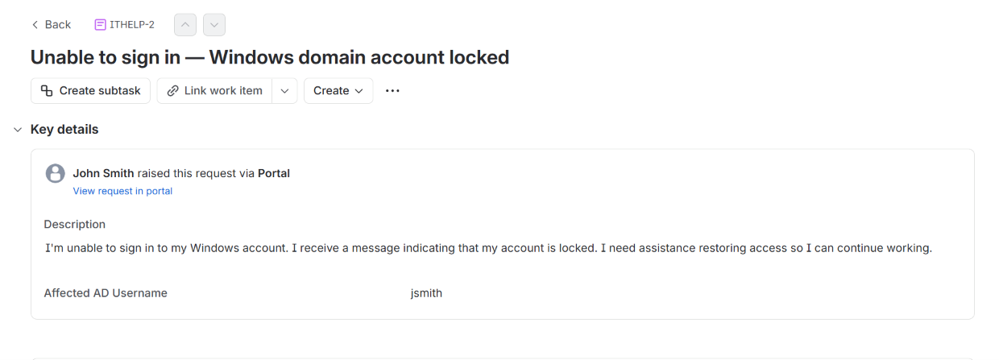
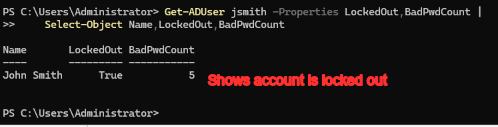
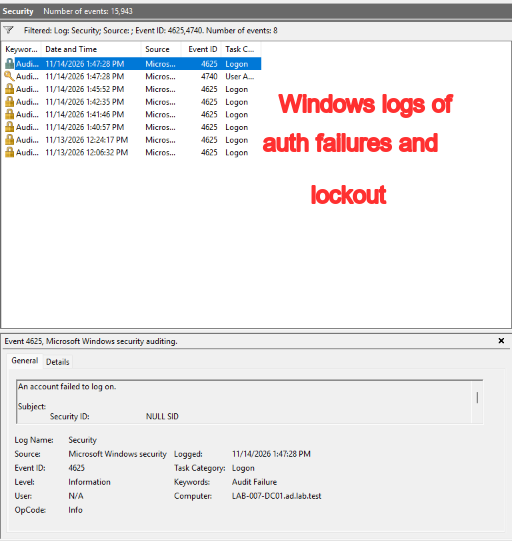
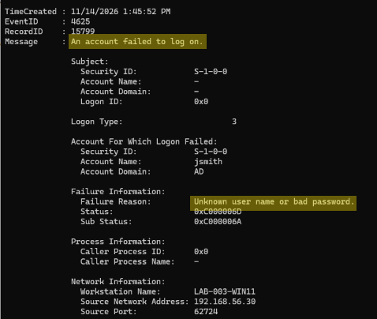
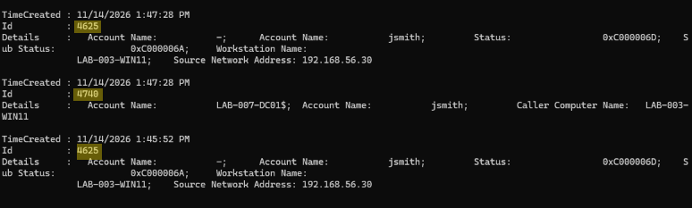
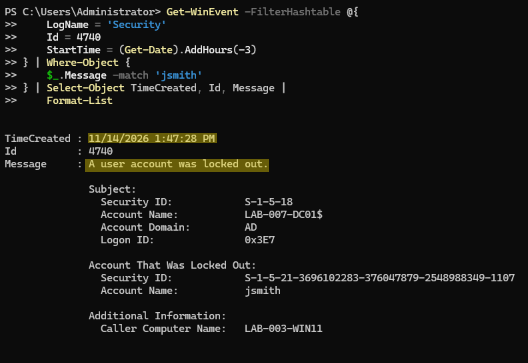
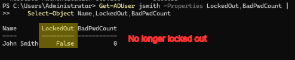

# Incident Report: IR-000006

**Case:** #6 - IR-05 - AR Account Lock  
**Client:**   
**Status:** Open  

## 1. Case Identification

IR-06 - AR Account Lock

Luke Morris

11/14/2026

## 2. Executive Summary

Repeated failed authentication attempts against the Active Directory account jsmith caused the account to become locked, temporarily preventing new domain logins. The attempts originated from workstation LAB-003-WIN11 and used incorrect credentials over an NTLM network authentication connection.

The incident was reported through a Jira Service Management ticket submitted by John Smith after he experienced an account lockout. Subsequent investigation of Windows Server Security logs identified Event ID 4740, confirming the lockout, and Event ID 4625, documenting the preceding failed authentication attempts.

The affected user was John Smith (AD\jsmith) in the ad.lab.test domain. Authentication failures originated from LAB-003-WIN11 (192.168.56.30) and were recorded by domain controller LAB-007-DC01, affecting John's ability to establish new authenticated sessions.

Windows Security Event 4740 confirmed the account lockout at 1:47:28 PM on November 14, 2026, while Event 4625 documented incorrect-password NTLM network authentication attempts from 192.168.56.30. Although the originating workstation and authentication method were identified, the collected logs did not independently establish the specific process responsible for initiating the attempts.

After communication with user jsmith it was confirmed to be legitimate authentication failures due to a lengthy password. His account was unlocked with the requirement he set a new password.

## 3. Detection and Alert Details

The event was discovered via a ticket submitted by jsmith on Jira, and Active Directory confirmed the activity.

The event signifiers were Windows Security Events 4740 and 4625 which confirmed the failed authentication attemps and account lockout.

The final failed authentication attempt and subesequent lockout occurred at 1:47:28 PM CST on 11/14/2026.

## 4. Initial Triage

The invesigation was prompted by the submission of an Account Lockout ticket on Jira by user jsmith.

The event was confirmed via checking if the account was locked on powershell and checking the Windows Server logs for the failed authentication attempts.

## 5. Investigation Scope

Account jsmith and machine LAB-003 - Windows 11 were investigated.

Data sources and tools available were Active Directory, Jira, and Suricata.

## 6. Evidence Collection

Screenshots were collected showing the normal baseline for jsmith, the new locked-out status, and the logs showing the authentication failures.

Data was collected from powershell queries and from Windows Server logs.

Evidence was collected shortly after the incident around 1:54:00 PM CST.

## 7. Technical Analysis

## 8. Event Timeline

The earliest relevant event occurred at 1:40:57 PM CST.

Immediately before detection, user jsmith failed to log on 5 times and was locked out, and sent a ticket afterwards.

## 9. Findings and Root Cause

The findings that are confirmed by evidence include the 5 failed login attempts and the status of jsmith as being locked out, which were confirmed by Windows Server logs and by AD powershell queries.

Root cause was ultimately a misremembrance by jsmith of his password for this particular machine. After consulting with him further it is believed to be due to his infrequent use of this machine that he forgot the password.

No contributing configuration or control weaknesses were observed. The 10 minute lockout for 5 failed attempts worked as expected.

No demonstration impact on integrity, confidentiality, or availability was detected.

## 10. Containment and Remediation

The actions were authorized and performed by Luke Morris, shortly after the ticket submission at 1:54:00 PM CST.

The account affected by remediation was jsmith, and the machine was LAB-003 - Windows 11.

No changes were made to rules or configurations. A change of credentials was enforced upon jsmith's account so the new credentials could be remembered.

## 11. Recovery and Validation

The Unlock account box was selected in Windows server and a rule was enforced to require password reset on jsmith's part.

Normal behavior was verified afterward by running the GetADUser command in powershell and extracting its properties, showing the account was no longer locked out.

## 12. Conclusion and Recommendations

The final incident disposition is that no changes to configuration needs to be made and the situation was human error.

## Timeline

| Time (UTC / source timezone) | Event |
| --- | --- |
| 1:47:28 PM | An account was locked out |
